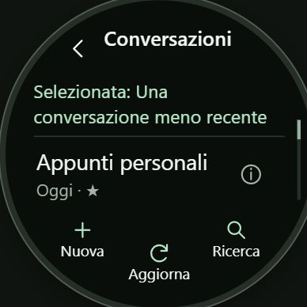
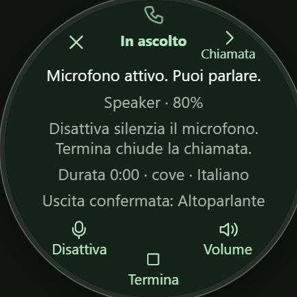
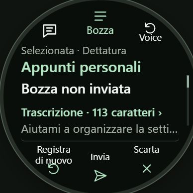
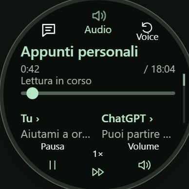

# Voxora

Voxora lets you use ChatGPT conversations from a Samsung Galaxy Watch7. Select a chat, start a live Voice call, or dictate a message and listen to the reply. The app also has conversation search, playback controls, audio settings, and Wear OS shortcuts.

This repository contains Voxora 0.4.1 (`versionCode 10`). **The watch menus are in Italian.** Changing the voice language does not change the menu language.

The prebuilt debug APK is distributed separately from the source through GitHub Releases when a release is available. Installation and account setup require a computer and ADB.

## What you can do

| On the watch          | What it does                                                                                                                                                  |
| --------------------- | ------------------------------------------------------------------------------------------------------------------------------------------------------------- |
| **Voice**             | Start a live conversation in the selected ChatGPT chat. See connection status, mute and unmute the watch microphone, end the call, and adjust speaker volume. |
| **Dictation**         | Record a spoken prompt, read the resulting draft, then send it or discard it and record again.                                                                |
| **Read Aloud**        | Listen to the text reply. Pause, resume, restart, change playback speed, and seek after the audio has finished downloading.                                   |
| **Conversations**     | Create a new chat, refresh the list, load older conversations, search among loaded titles, select a chat, and keep local favorites.                           |
| **Settings**          | Select a voice and spoken language, choose an available audio output, change volume, and adjust captions, text size, vibrations, and screen behavior.         |
| **Wear OS shortcuts** | Open Voxora, prepare a new chat, or resume the last selection from the tile; a watch-face complication entry is also included.                                |

Voice opens a live audio session. Dictation sends a text message and reads the reply aloud. The [watch guide](docs/USING_VOXORA.md) explains both sets of controls.

## Interface examples

These UI renderings are from the October 15, 2026 interface audit. They contain demonstration text, not messages from a real ChatGPT session.

| Conversations                                                                                            | Live Voice                                                                                                | Dictation                                                                                                | Read Aloud                                                                                                 |
|:--------------------------------------------------------------------------------------------------------:|:---------------------------------------------------------------------------------------------------------:|:--------------------------------------------------------------------------------------------------------:|:----------------------------------------------------------------------------------------------------------:|
|  |  |  |  |

## Install the APK and connect your account

You do not need to build the app to install the prebuilt APK. When a release is available:

1. Download `Voxora-0.4.1-debug-bundle.zip` and verify the APK checksum.
2. Enable wireless debugging on the Watch, pair it with your computer, then install the APK using `adb`.
3. On that computer, run `node tools/provision-once.mjs` from the extracted bundle. The helper opens a local form to transfer your ChatGPT web-session material to the app's private storage on the Watch.
4. Open Voxora and choose a conversation or start a new one.

Follow the [installation guide](docs/INSTALL_AND_SETUP.md) for ADB pairing and setup commands on Windows, macOS, or Linux. See [Using Voxora](docs/USING_VOXORA.md) for watch controls and [Troubleshooting](docs/TROUBLESHOOTING.md) for common failures.

You enter your account session after installing the APK. The source code and APK contain no account credentials. Treat session cookies as passwords: never include them in an issue, screenshot, or message.

## Requirements and known limits

- Tested device: **Samsung Galaxy Watch7**. Other Wear OS models have not been independently validated.
- The watch needs network access. Voxora can use Wi-Fi or the internet connection routed through a paired phone, subject to the actual connection and service availability.
- The installation helper currently requires a **debuggable** APK and `adb run-as`. This is a development-oriented distribution path, not a Play Store or signed production package.
- Voice and Dictation rely on ChatGPT **web** session behavior and interfaces that can change independently of Voxora. This is not an official OpenAI Voice SDK or a guaranteed stable integration.
- A ChatGPT account's usage limits and availability still apply. Voxora does not provide a separate model subscription or API key.
- The app's menus and labels remain in Italian. The setup helper is currently run from a computer rather than directly on the watch.

## Build from source

Use **JDK 17**, **Android SDK Platform 35**, **Android Build Tools 35.0.0**, and network access to Google Maven and Maven Central. The project uses Android Gradle Plugin **8.8.2** and the included **Gradle 8.10.2** wrapper. Set `ANDROID_HOME`/`ANDROID_SDK_ROOT`, or add an ignored `local.properties` with `sdk.dir`.

Windows:

```powershell
.\gradlew.bat testDebugUnitTest assembleDebug lintDebug
```

macOS/Linux:

```sh
sh ./gradlew testDebugUnitTest assembleDebug lintDebug
```

You can also run `./build.ps1` on Windows PowerShell. The generated development APK appears under `app/build/outputs/apk/debug/`. This is separate from the APK prepared as a release asset.

The [GitHub Actions workflow](.github/workflows/android-ci.yml) runs unit tests, a debug build, and lint with JDK 17 and Android SDK 35. It does not sign or publish APKs or test on a physical watch.

## Contributing

**Contributions are welcome.** Bug reports, installation and documentation improvements, accessibility work, and focused code changes are all useful. Read [CONTRIBUTING.md](CONTRIBUTING.md) for how to open an issue or pull request, run checks, and share logs without exposing private account data.

## Code provenance and licenses

The project license is in [LICENSE](LICENSE). Voice protocol integration includes code adapted from [opencoredev/login-with-chatgpt](https://github.com/opencoredev/login-with-chatgpt) at revision `3befb7fb625170cb305b116a654c7e2f8672bae4`, under the MIT License. See [NOTICE](NOTICE), the [upstream license](third_party/login-with-chatgpt-LICENSE.txt), and [third-party notices](THIRD_PARTY_NOTICES.md).

This project is independent and **is not affiliated with or endorsed by OpenAI**.
